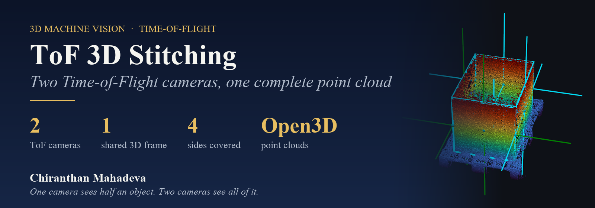
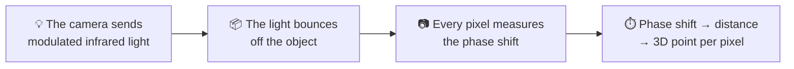
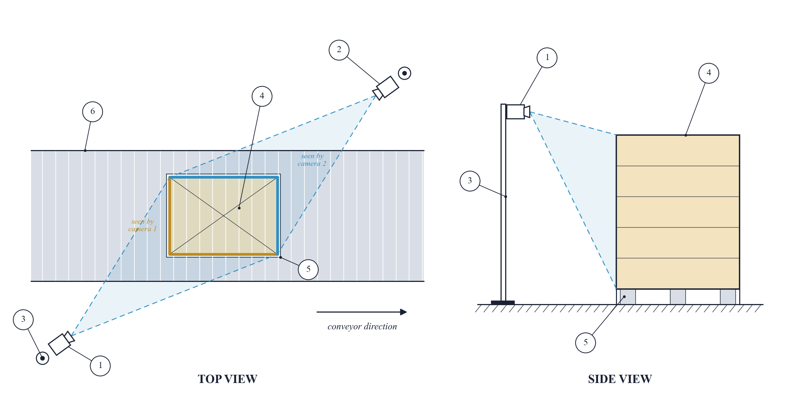
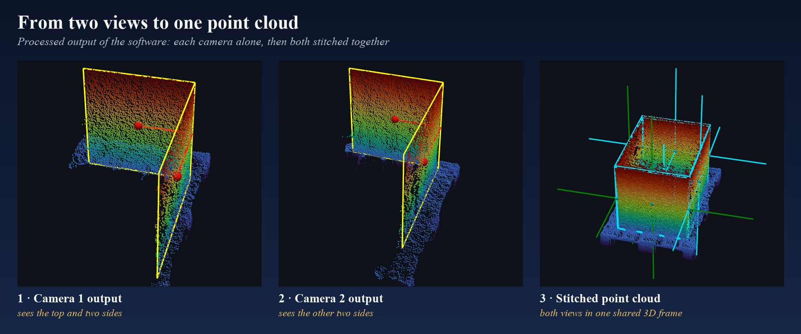
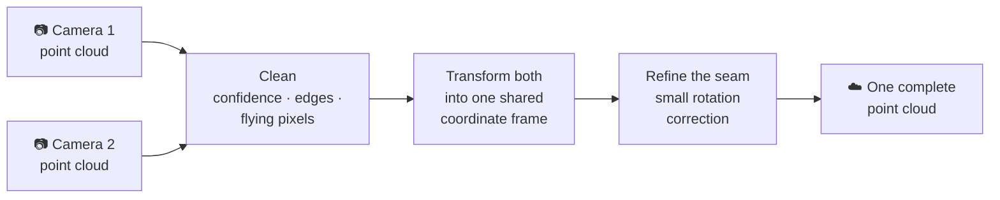

  

  
  
  

  <b>Two Time-of-Flight cameras look at an object from opposite corners. 
  Stitching their point clouds gives one complete 3D view of all sides.</b>

> **Source code is private.** It was developed in an industrial project. This page explains the method using my own test captures.

---

## 💡 How a Time-of-Flight camera sees in 3D

Every pixel gets its own distance, so a single shot gives a full **point cloud**: thousands of X, Y, Z points. ToF needs no surface texture, so plain, uniform surfaces work well.

## 👀 Why one camera isn't enough

A camera at one corner sees the top and **only two sides**. The back is hidden. A second camera at the **diagonally opposite corner** sees the other two sides.

**①** camera 1 · **②** camera 2 at the opposite corner · **③** camera masts · **④** object · **⑤** pallet · **⑥** conveyor

## 🧩 Stitching two clouds into one

1. **Capture**: both ToF cameras record a point cloud.
2. **Clean**: low-confidence points, edge artefacts and flying pixels are removed.
3. **Transform**: each camera's known mounting pose moves its cloud into **one shared 3D coordinate frame**.
4. **Refine the seam**: a small rotation correction lines up the two halves where they meet.
5. **Result**: one cloud showing **all four sides** of the object.

## 🧰 Tech stack

**Python** · **Open3D** · **NumPy** · Time-of-Flight camera SDK

---

  <b>Chiranthan Mahadeva</b> · Industrial machine vision & 3D 
  More: <a href="https://github.com/Gojoinferno/Stereo3D-BucketPose">Stereo3D-BucketPose</a> ·
  <a href="https://github.com/Gojoinferno/MachineVision-Research">MachineVision-Research</a>

